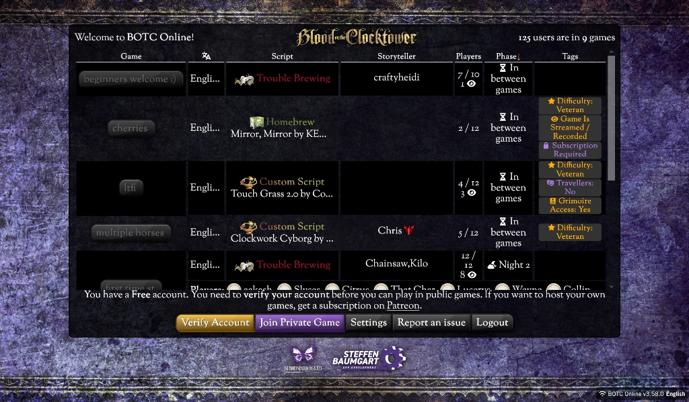

# UI Reference: Official BOTC Online (botc.app)

*Date: 2026-11-06*  
*Source: Official Blood on the Clocktower app (v3.58.0) by The Pandemonium Institute & Steffen Baumgart*  
*Context: Reference suggested by Emanuel for visual alignment.*

---

## 🎨 Visual Identity & Design Tokens

### 1. Background & Atmosphere
* **Velvet Parchment Backdrop:** Deep royal violet / bruised purple crushed velvet texture (`#1c0f2b` to `#0d0714`). Gives the feeling of an occult ritual book or magician's table cloth.
* **Content Cards & Containers:** Solid pitch-black or near-black (`#09090d` / `#111116`) to maintain maximum readability and WCAG contrast against the textured background.

### 2. Script Type Color Coding
* **Trouble Brewing:** Crimson Red (`#dc2626` / `#ef4444`) with book/wings icon.
* **Bad Moon Rising:** Moonlit Amber / Golden yellow (`#f59e0b`).
* **Sects & Violets:** Deep Violet / Orchid (`#a855f7`).
* **Custom Scripts:** Warm Ochre / Orange (`#ea580c` / `#f97316`).
* **Homebrew:** Toxic Emerald Green (`#10b981` / `#22c55e`) with flask/skull icon.

### 3. Button Styles & Interactive Elements
* **Primary / Highlight Buttons:** Gold gradient with dark border and dark text (`#d4af37` gradient) — used for "Verify Account".
* **Secondary Buttons:** Deep purple gradient with white text (`#581c87` to `#3b0764`) — used for "Join Private Game".
* **Neutral Action Buttons:** Glassmorphic translucent dark grey with subtle 1px border — used for "Settings", "Report an issue", "Logout".
* **Pill Chips / Game Rooms:** Dark embossed pills with subtle inset glow (e.g. `beginners welcome :)`, `cherries`).

### 4. Status Tags & Badges
* **Phase Badges:** 
  * `⌛ In between games`
  * `🌙 Night 2`
* **Metadata Tags:**
  * Star Gold tag: `★ Difficulty: Veteran`
  * Stream tag: `⦿ Game Is Streamed / Recorded`
  * Lock tag: `🔒 Subscription Required`
  * Grimoire status: `📖 Grimoire Access: Yes`
* **Player Counters:** Compact fraction `7 / 10` with spectator eye counter `1 👁️`.

### 5. Typography Hierarchy
* **Title Header:** Ornate gothic medieval font with flourishes in warm gold (`Blood on the Clocktower`).
* **UI & Data Rows:** Highly readable, clean modern sans-serif (Inter / Roboto style) with generous letter-spacing for numbers and player counts.

---

## 📱 Application to Pocket Grimoire (Mobile)

When the team finalizes the design direction, these patterns translate directly into our mobile PWA:
1. **Background:** We can introduce the royal violet velvet undertone into the header and drawer navigation.
2. **Script colors:** Match the exact official colors when loading scripts (TB = Red, Custom = Orange).
3. **Pill buttons:** Use the official soft-rounded dark pills for seat tokens and status indicators.
4. **Phase badges:** Adopt the clean `🌙 Night X` and `☀️ Day X` chip styling from the official app.
